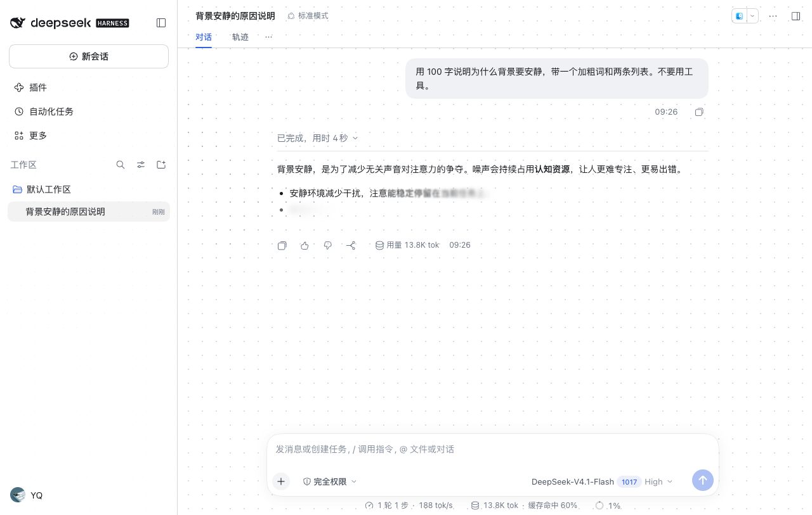
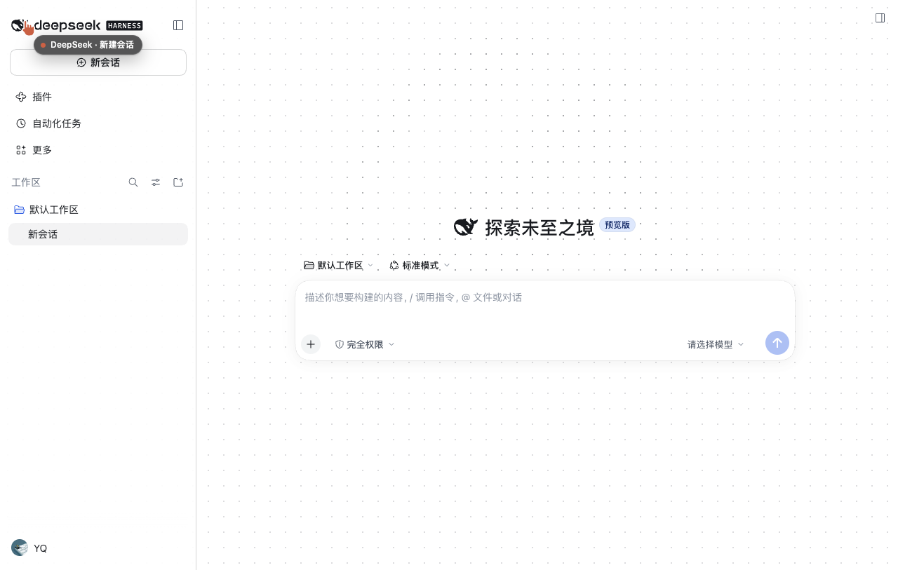

# dsh-quiet

给 [DeepSeek Harness](https://github.com/deepseek-ai/deepseek-harness) 网页客户端加两件「安静」的视觉：**灰色点阵与游动的鲸鱼背景**，以及 **AI 回复由模糊到清晰的逐字浮现**，并接管日/夜两套配色。

Quiet visual layer for the DeepSeek Harness web client: a dot-matrix backdrop with a slowly swimming whale, blur-to-clear character reveal for streaming replies, and a day/night palette. Grayscale only, no glow, no click ripples.





## 它做了什么

### 背景：点阵 + 鲸鱼

- 一张 `position: fixed` 的全屏 canvas 贴在 `body` 最前面，`pointer-events: none`、`z-index: 0`；点阵**只画在聊天区**里（侧栏与标题栏保持干净），这块区域从输入框往上自动解析，面板开合、侧栏收起都会重算；
- 点阵间距 22px、点半径 1px；
- 鲸鱼不是另画的图案：**同一片点阵里落在鲸鱼形状内的点**才变深，点的大小完全一样。
  形状取自 `@deepseek-ai/dsh-client-ui-primitives` 导出的 `FISH_LOGO_PATH`（官方鲸鱼路径），
  栅格化成羽化遮罩后每帧查表；
- 日间：背景点 0.14 / 鲸鱼内 0.34；夜间：0.09 / 0.22。全部中性灰，不加光晕；
- 游动：巡航 34px/s，AI 回复中 46px/s，**永不停止**；靠近边缘才掉头，走一段椭圆弧，掉头时微微变淡；
- 身体沿身长做正弦弯曲、尾巴绕尾根摆动、整体轻微上下浮动；
- 鼠标靠近只让方向轻微偏转，太近则绕开；
- 输入框里打字时，喷气孔冒小气泡圈；发送消息时甩尾 + 喷一小簇点。

### 回复：逐字浮现

- 模型流式返回的文字先进队列，不直接渲染；
- `requestAnimationFrame` 时钟按 40 字/秒放字，开头 0.7s 用 smoothstep 从 35% 加速；队列将空时降速；积压时最多提速 6 倍追赶；
- 每个字一个 `span`，两段 CSS 动画：透明度 + 颜色（0.68s）、`blur(10px) → 0`（0.86s），`cubic-bezier(.22,1,.36,1)`，不加任何位移；
- 同帧多字用负 `animation-delay` 补回各自的时刻，形成连续的波；
- `blur` 动画结束即换回文本节点，同时在动的元素恒定在几十个；
- 流式期间按 Markdown 子集解析（段落 / 标题 / 列表 / 加粗 / 行内代码），结束后整体切换成原生渲染。

### 日 / 夜

跟随 Harness 的外观设置（默认跟随系统）。底部、正文、气泡、边框等一组 token 用 `theme.overrideTokens` 覆盖，不修改主题文件；canvas 与界面都在约 400ms 内过渡。

## 安装

在 Harness 的 **插件页** 里安装本仓库（bundle），或命令行：

```sh
dsh plugin --profile <your-profile> add github:AvenYQ/dsh-quiet
```

安装后在「插件」页里会多出一行 **dsh-quiet**，关掉即恢复原生渲染，无需重启。

> 桌面端应用的 profile 由应用自己管理，CLI 的 `dsh plugin` 会被拒绝；那种情况下用「插件」页安装。

## 与 ds-bot 共存

聊天席位按优先级分层，不做模式判断：Chat 原生回复 `0`，本插件 `-50`，ds-bot 气泡模式 `-100`。
所以原生界面用 dsh-quiet，气泡界面仍然归 ds-bot。

## 调参

| 想改什么 | 在哪儿 |
|---|---|
| 底色 / 点阵浓度 | `lib/client.js` 的 `PALETTES`（`baseAlpha` / `whaleAlpha`） |
| 游动速度、掉头时长与弧半径 | `createBackdrop({ cruise, cruiseActive, turnSeconds, turnRadiusX, turnRadiusY })` |
| 出字速度与追赶 | `createRevealer({ rate, maxBoost })` |
| 浮现动画时长 | CSS 里 `.dshr_tk` 的两段 `animation` |
| 夜间/日间配色 | `TOKENS` 表（`{ light, dark }` 成对） |
| 起始灰 / 模糊半径 | CSS 变量 `--dshr-from` / `--dshr-blur` |

## 已知取舍

1. **掉头是 2.2 秒的椭圆弧（170×80），不是 1.8 秒 / 200px 半径**。半径 200 配 1.8 秒意味着弧线上要跑约 350px/s（巡航的十倍），会「嗖」地掠过去；改扁之后约 130px/s，也不会把鲸鱼甩出屏幕。两个数都是参数。
2. **流式期间只支持 Markdown 子集**：代码块、表格、链接在流式中是纯文字，结束后才成形。
3. **出字速率有界追赶**：满速 40 字/秒，队列积压超过 0.8 秒的量时最多 6 倍，否则高速模型会让「已完成」已经挂在屏幕上、字幕还在慢慢爬。
4. `--dsw-alias-bg-base` 被改成 `transparent` 让点阵透出来；弹层与输入框用的是 layer token，仍然是不透明底，阅读不受影响。

## 兼容性

在 DeepSeek Harness 0.2.1-rc.5 上验证（真实会话）。纯前端插件，不在 Host 侧注册任何东西，不发网络请求，不读写凭据。

## License

MIT
